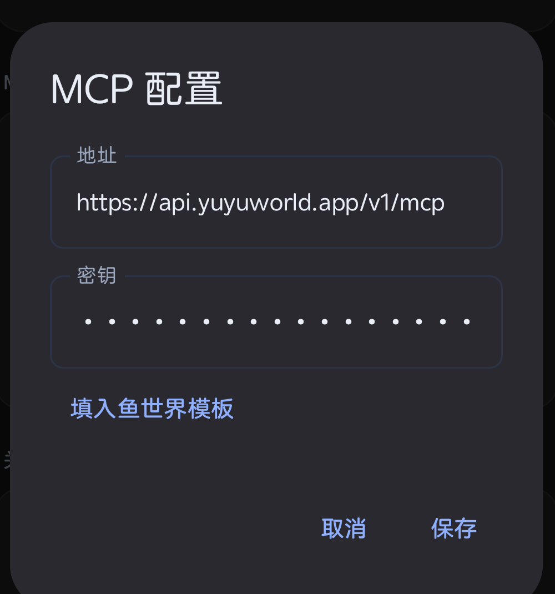

# AIcode

[](https://github.com/CYYYOURMAN/AICode/actions/workflows/build-apk.yml)

**把一台自己的 Linux 服务器变成「AI 手机助手」。**
手机 App 连上你自己托管的 [DSH](https://github.com/deepseek-ai/deepseek-harness) 引擎：
能对话、读写文件、跑命令、操作手机——数据和服务全在你自己手里。

## 架构

```
┌─────────────┐   Bearer / 局域网或 HTTPS    ┌──────────────────────────────┐
│  手机 App    │ ───────────────────────────> │  AIcode Gateway (:3300)       │
│ (android/)  │ <─────────────────────────── │  ├─ token 下发 / 配对         │
└─────────────┘                              │  ├─ 手机控制命令队列           │
                                             │  ├─ App 更新通道 / 崩溃上报    │
                                             │  └─ /exec（默认关闭）          │
                                             └──────────────┬───────────────┘
                                                            │ 同容器 / host 网络
                                             ┌──────────────▼───────────────┐
                                             │  DSH 引擎 (:3080, MIT)        │
                                             │  对话 / 工具 / 工作区          │
                                             └──────────────────────────────┘
```

## 下载 APK（已签名，可直接安装）

- App：https://github.com/CYYYOURMAN/AICode/releases/latest/download/aicode-latest.apk
- 备用（raw 直链，国内时通时断）：https://raw.githubusercontent.com/CYYYOURMAN/AICode/main/download/aicode-latest.apk
- 部署指南（发给自己的 AI 照做）：https://cyyyourman.github.io/AICode/deploy-for-ai.md

## 前置条件

- 一台 Linux 服务器（NAS / VPS / 小主机都行），装好 Docker 和 Docker Compose；
- 一个 DSH 能用的模型 API key（当前是 DeepSeek 官方 key）；
- 手机：Android 8.0+。

## 快速开始（服务端）

```bash
git clone https://github.com/CYYYOURMAN/AICode.git aicode && cd aicode
cp .env.example .env
# 编辑 .env：填 DEEPSEEK_API_KEY（其余可默认）
docker compose up -d --build
```

第一次启动会构建镜像（下载 DSH 引擎），大约几分钟。起来后：

```bash
docker compose logs -f aicode          # 看网关日志
docker compose exec aicode cat /data/pair-code    # 配对码（6 位数字）
docker compose exec aicode cat /data/secret       # 共享密钥（不想配对时可手填）
```

- 网关：`http://你的服务器IP:3300`
- 引擎：`http://你的服务器IP:3080`
- 健康检查：`curl http://你的服务器IP:3300/health`

## App 预览

<p>


</p>

## 连接手机（配对）

1. 装 App：从 [Releases](https://github.com/CYYYOURMAN/AICode/releases) 下载 APK，或自己构建（见下）；
2. 打开 App，首次会停在「连接服务器」页；
3. 填 **服务器地址**（例如 `http://192.168.1.10:3300`，或 Tailscale 地址、HTTPS 域名）；
4. 填 **配对码**（上面的 `cat /data/pair-code`，6 位数字）；
5. 点「连接」——成功后自动取 token，进入对话。

> 配对码用一次就换新的；密钥只存在手机本地，App 里不会再显示明文。
> 不想跑配对流程时，点「我只想输入密钥」，直接填 `cat /data/secret` 的内容。

**地址填哪个？**
- 只在家用：服务器局域网 IP（`http://192.168.1.10:3300`）最快；
- 在家和外面都要用：Tailscale IP（`http://100.x.x.x:3300`）或套了 HTTPS 的域名；
- 地址只填一个，改地址在 App 设置页「重新配对」。

## 构建 App（可选）

App 是标准 Android 工程（Kotlin + Compose），在 `android/` 目录：

```bash
cd android
# 需要 JDK 17 + Android SDK（ANDROID_HOME）
gradle assembleRelease     # 或 ./gradlew assembleRelease
```

- 不配签名文件时产出 unsigned APK；自己用的话用 Android Studio 的调试签名装即可。
- 推 `v*` tag 时 GitHub Actions 会自动构建并把 APK 上传到 Actions artifact（需要登录 GitHub 下载，
  在对应 run 页面底部 "Artifacts" 里）。
- Release 签名：在 `keystore.properties`（不进 git）里配 `storeFile` / `storePassword` / `keyAlias` / `keyPassword`。

## 推荐的安全部署

**不要直接把 3300/3080 裸奔到公网。** 二选一：

1. **Tailscale（最省事）**：服务器和手机都装 Tailscale，App 地址填 `http://<tailscale-ip>:3300`，
   不暴露公网端口。
2. **反向代理 + HTTPS（Caddy 示例）**：

```
aicode.example.com {
    reverse_proxy 127.0.0.1:3080
}
gateway.example.com {
    reverse_proxy 127.0.0.1:3300
}
```

然后在 `.env` 里把 `DSH_BASE` 设为 `https://aicode.example.com`。

## 手机控制（可选）

`PHONE_ENABLED=1` 时，网关提供手机控制命令通道（`/phone/*`）。App 里需要手动开启
「无障碍服务」和「悬浮窗」权限；root 不是必需项。

## 远程命令执行（默认关闭）

文件页的删除/重命名/新建依赖 `/exec`（服务器上执行 shell）。开源版**默认关闭**：
`EXEC_ENABLED=0`。需要时在 `.env` 里打开，并理解这意味着「任何拿到网关密钥的人都能在服务器上执行命令」。

## 目录结构

```
AICode/
├── docker-compose.yml
├── .env.example
├── gateway/                 # 服务端网关（Python，stdlib）
│   ├── Dockerfile
│   ├── entrypoint.sh        # 起 DSH + 网关
│   └── gateway.py           # token/配对/手机控制/更新/崩溃
├── android/                 # Android App（Kotlin + Compose）
│   ├── app/src/main/java/com/aicode/app/...
│   └── ...
├── docs/
│   ├── HTTPS.md             # 外网访问：Tailscale / Caddy / Nginx
│   └── MCP.md               # 自定义 MCP 集成（鱼世界示例）
├── .github/                 # issue/PR 模板、CI 构建 APK
├── SECURITY.md
├── CONTRIBUTING.md
├── README.md
└── LICENSE
```

## 路线图

- [x] M0：网关通用化骨架 + Docker 部署
- [x] M1：容器构建与接口验证（token/配对/健康检查）
- [x] M2：App 连接向导（地址 + 配对码）、运行时配置、连接诊断
- [x] M3：App 源码开源、去个人化、版本号自动递增
- [x] M4：社区化（issue/PR 模板、CONTRIBUTING、HTTPS 指南、MCP 示例）

## 文档

- [外网访问 / HTTPS 指南](docs/HTTPS.md)
- [自定义 MCP 集成](docs/MCP.md)
- [贡献指南](CONTRIBUTING.md)
- [安全模型](SECURITY.md)

## License

MIT（DSH 引擎本身也是 MIT）。
